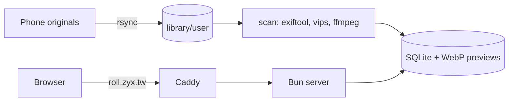

<div align="center">

<h1>roll</h1>

<p><strong>Your photos and videos on your own server, one private timeline per person.</strong></p>

**English** | [繁體中文](README.zh-TW.md)

</div>

You copy the originals from a phone to the server. roll reads them, makes small previews and shows them as one timeline, newest first. Each person signs in with a passkey and sees only their own photos.

## Features

- **Sign in with a passkey**: Touch ID or Face ID, no password.
- **Invite a person**: a one-time link registers a passkey for one account.
- **Browse a timeline**: a masonry wall in capture order, loaded page by page.
- **Search in one box**: dates (`4/15`, `2026 年 4 月`), towns (`京都`, `Kyoto`), countries (`日本`) and kinds (`自拍`, `截圖`, `影片`, `原況`, `全景`), combined; press `/` or Cmd+K.
- **Search by meaning**: other words find photos and video frames that show them (`海邊`, `京都拉麵`), and text inside photos comes first (screenshots, menus, tickets).
- **Upload**: pick files or drop them on the page; originals keep every byte.
- **Delete**: a photo moves to `<user>/.trash/<day>/`, out of the timeline.
- **Open a photo**: a full-screen viewer with arrow keys, swipe and download of the original.
- **Keep iPhone formats**: HEIC photos, HEVC videos and Live Photos play as they are.

## Quick start

```sh
bun install
bun run build
bun server/index.ts invite loki Loki
bun run start
```

Open the printed link and register a passkey. Copy photos into `data/library/loki/`; a scan picks them up.

## Usage

1. Run `bun build/server.js invite <user id> <name>` on the server.
2. Send the printed link to that person. It works once, for 7 days.
3. Copy that person's originals into `/srv/roll/library/<user id>/` with rsync.
4. Wait for the next scan, every 15 minutes, or restart the service.

## Configuration

| Key | Sets | Default |
|-----|------|---------|
| `ROLL_ORIGIN` | the app origin, also the passkey RP ID | `http://localhost:8080` |
| `ROLL_DATA` | the folder for the database, previews and the library | `./data` |
| `ROLL_LIBRARY` | the originals, one folder per user | `<ROLL_DATA>/library` |
| `ROLL_DIST` | the built web app | `./dist` |
| `ROLL_PORT` | the listen port | `8080` |
| `ROLL_SCAN_MINUTES` | minutes between library scans | `15` |
| `ROLL_WORKERS` | previews made at once | `2` |
| `ROLL_GEONAMES` | GeoNames `cities1000.txt`, for town names | `<ROLL_DATA>/geo/cities1000.txt` |
| `ROLL_RESERVE_GB` | disk space an upload must leave free | `10` |
| `ROLL_EMBED_URL` | the zyx1121/embed service, for search by meaning and text in photos | off |
| `ROLL_EMBED_TOKEN` | its bearer token | none |
| `OTEL_EXPORTER_OTLP_ENDPOINT` | where OTLP/HTTP JSON logs go | off |

## How it works



A scan walks each user's folder. It reads capture time and GPS with exiftool, and makes a 2048 px and a 640 px WebP with vips. A video gives its first frame through ffmpeg. A photo and a video with the same name form a Live Photo. Every API lookup takes the photo id and the signed-in user together.

After the previews, each photo goes once to the embed service: a vector for the 2048 px preview and its text (OCR), or vectors for 3 frames of a video. EXIF marks selfies and screenshots. A search with free words ranks the photos its other words allow: text matches first, then photos whose meaning is 1.5 standard deviations above the mean.

## For AI agents

Facts for coding agents and LLM tools. The rules for changing the code are in [AGENTS.md](AGENTS.md).

- **Summary**: A private photo and video timeline for a few people, with passkey login and invite links.
- **Type**: service
- **Interfaces**: HTTP `https://roll.zyx.tw/api` (session cookie), CLI `invite <user id> [name]`
- **Install**: `bun install`, plus `exiftool`, `vips` with HEIF and `ffmpeg` on the host
- **Run**: `bun run start`
- **Verify**: `bun test server`
- **Config**: `ROLL_ORIGIN`, `ROLL_DATA`, `ROLL_LIBRARY`, `ROLL_DIST`, `ROLL_PORT`, `ROLL_SCAN_MINUTES`, `ROLL_WORKERS`, `ROLL_RESERVE_GB`, `ROLL_GEONAMES`, `ROLL_EMBED_URL`, `ROLL_EMBED_TOKEN`, `OTEL_EXPORTER_OTLP_ENDPOINT`, `OTEL_EXPORTER_OTLP_HEADERS`, `OTEL_SERVICE_NAME`
- **Secrets**: the OTLP header and `ROLL_EMBED_TOKEN` live in `/etc/roll/env` on the server.
- **Limits**: Search by meaning needs the embed service; people (faces) come later.

## Development

```sh
git clone https://github.com/zyx1121/roll && cd roll
bun install
bun test server && bun run typecheck && bun run lint
```

`scripts/deploy.sh` tests, builds and ships to the server.

## License

[MIT](LICENSE)

## iOS app

`ios/` holds a SwiftUI app that uploads originals straight from Photos. Safari transcodes videos before a web upload; the app reads the original files through PhotoKit instead.

- Build and test in Xcode, or with `xcodebuild -project ios/Roll.xcodeproj -scheme Roll`.
- `ios/upload.sh` archives and uploads a build to TestFlight with the App Store Connect API key.
- Debug builds accept `-rollSession <token>` and `-rollUploadRecent <n>` to test in the simulator without a passkey or the picker.
